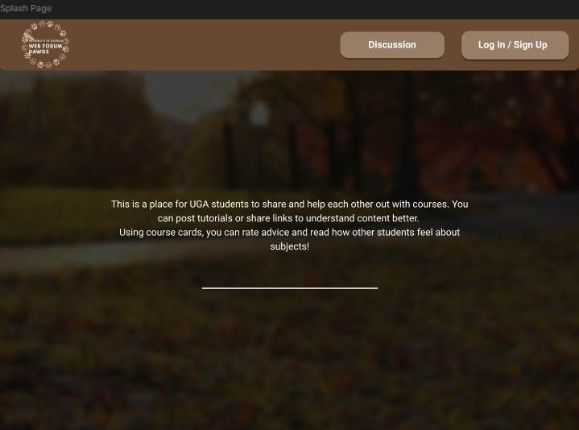
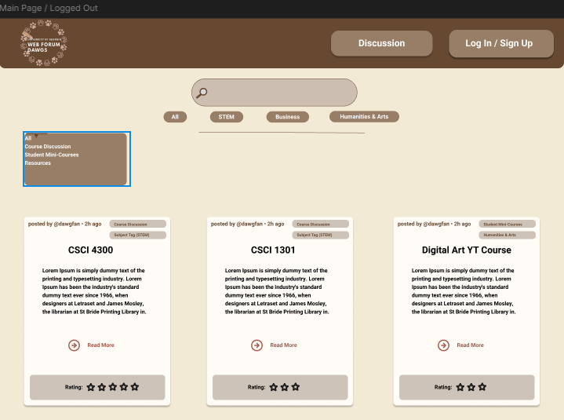
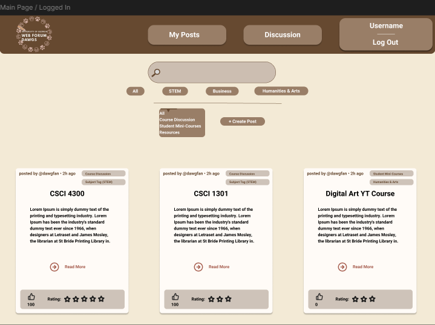
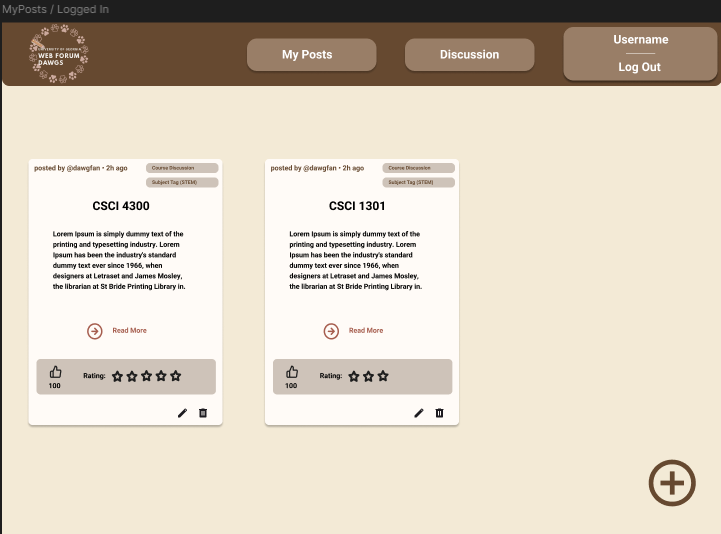
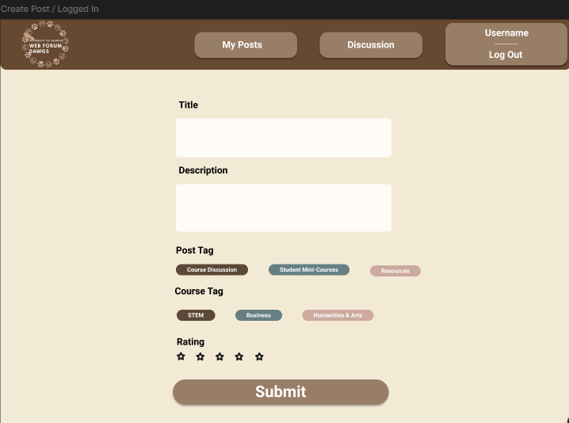

# Class Forum

## Our Group
- Pranavi Veluguleti
- Connor Torkelson
- Tyler Gemmel
---

class section: PM
- webDawgs

---
## Splash page

First view once on the website, allows for login or signup. Also gives a breif description of what the webiste is about, and a link to our discussion page.
---

## Non-authenticated view

The unathenticated view of the main page, doesn't allow for the altering or creation of cards, but does allow certain cards to be seen.
---

## Authenticated view

The Authenticated view gives the same view but switches the nav bar's sign in to sign out. Also adds a my post selection to the navbar to go to the My Posts page.

---

## Add/Edit Form

The add card page allows the user to make a card and have it posted, other users will then be able to see and rate the card.

---
