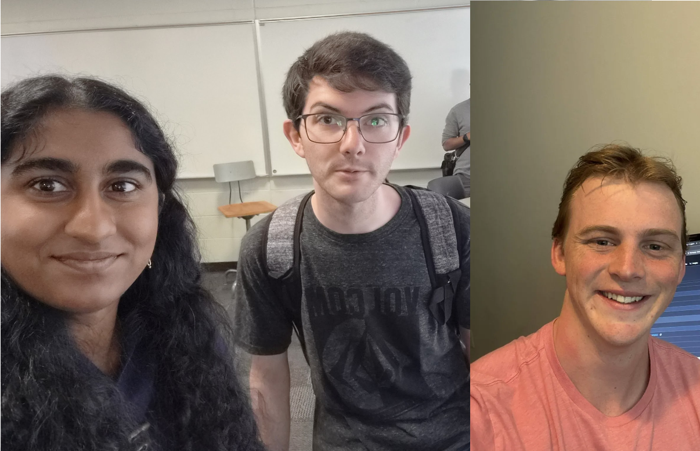

# Weekly Status Report

**Project Name: Web Forum Dawgs**  
**Group Name: webDawgs**  
**Project Manager: Pranavi Veluguleti**  

---

## Group Selfie
Upload image to `/images/` and link it below:

---
## Progress Summary - **Week #1:**  Monday, October 12th -  Sunday, October 18th

** What we completed this week:**  
- Finished our Figma outline for what we'd want our UI to look like.
- Made sure that CRUD operations were implemented in our website in Figma

** Issues / blockers encountered:**  
-  We didn't really know how to use Figma
-  Coming up with a nice design and logical layout for user interactivity

** Goals for next week:**  
-  Begin coding our planned Figma UI
-  Try to finish front end development

---

## Progress Summary - **Week #2:**  Monday, October 19th -  Sunday, October 25th

** What we completed this week:**  
- Finished a lot of tailwind css for website formatting
- Made it so that the website can be mobile friendly
- Made almost all buttons interactive and functional
- Made the form console.log
- Made star rating update on card and also like toggle
- Made a temporary user login state so that we can simulate the signin or signup button actually having a user log in
- Made all routes that we'll need on our website

** Issues / blockers encountered:**  
-  Device size with tailwind was kind of hard
-  Getting the like toggle and star ratings was a bit hard
-  Finding a way to fix merge conflicts
-  Figuring out how to do auth without always having to change variables in discussion and splash
-  Realized needed way to do api representation on our cards, we talked it out tho

** Goals for next week:**  
-  begin the search bar feature where we use tags as a requirement in the search
-  Study up on backend so we can make a card component appear on discussions page
-  Fix css on mypost page
-  Make read me button when signed in have a popup with scroll down to see full description
-  Work mostly in discussion page as that is where the most complex functionality is

---

## Progress Summary - **Week #3:**  Monday, October 26th -  Sunday, November 1st

** What we completed this week:**  
- Tyler working on fixing frontend to backend code
- Conner working on figuring out how to use MongoDB
- I (Pranavi) am working on setting up a mongodb connection

** Issues / blockers encountered:**  
-  MongoDB connection setup was erroring out because our home page.tsx is client side so I (Pranavi) had to make it a GET to get success message to print.
-  Figuring out how to organize backend and fix our front end for all of us.

** Goals for next week:**  
-  Get add/delete set up for cards
-  Start on api for resource cards
-  Start on search feature
-  We will split up work since they are more major components.

---

## Progress Summary - **Week #4:**  Monday, November 2nd -  Sunday, November 8th

** What we completed this week:**  
- 
-  

** Issues / blockers encountered:**  
-  
-  

** Goals for next week:**  
-  
-  

---

## Progress Summary - **Final Week:**  Monday, November 9th -  Sunday, November 15th

** What we completed this week:**  
- 
-  

** Issues / blockers encountered:**  
-  
-  

** Video preparation plans:**  
-  
-  
** Presentation preparation plans:**  
-  
-  
---

